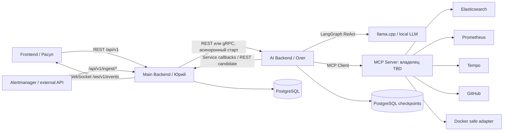

# 01. Архитектура и ответственность

## 1. Прямая архитектура, без брокера

**Main Backend** — единственный публичный HTTP API для браузера, владеет пользователями, RBAC, Project/Environment/Service, Incident, Investigation metadata, гипотезами, доказательствами, RCA и WebSocket. Подразделение на внутренние микросервисы — решение Юрия.

**AI Backend** — самостоятельный HTTP/gRPC-сервис в отдельном контейнере, владеет LangGraph, checkpointing, вызовами MCP, ресурсными лимитами, cancel, выходной структурой RCA и внутренним состоянием обработки. Main Backend не вызывает LangGraph напрямую.

**MCP Server** — слой *read-only диагностических инструментов*. Первоначально предполагался на стороне Юрия, позднее обсуждалось его размещение/часть на стороне AI. **Окончательный owner и topology TBD.** Можно сделать один MCP Server либо адаптеры, но стабильное имя и input/output каждого MCP tool нельзя менять без версионирования. MCP не предназначен для запуска расследования из Main Backend.

**Infra** — Docker Compose, monitoring, observability, persistence, CI/CD; llama.cpp может работать нативно на macOS, AI контейнер обращается к `host.docker.internal`.

## 2. Сквозной сценарий

1. Alertmanager вызывает защищённый `POST /api/v1/ingest/alertmanager` (или generic API).
2. Backend нормализует/дедуплицирует alert и сохраняет Incident со статусом `open`; может автоматически инициировать investigation по настроенной политике.
3. Backend создаёт `investigation_id`, записывает run со статусом `pending`, вызывает AI Backend напрямую (REST mapping: `POST /internal/v1/investigations`).
4. AI подтверждает `202 Accepted` **только после устойчивой записи запуска**, начинает обработку вне HTTP request handler.
5. AI публикует callbacks `events`/`results` на заранее сконфигурированный адрес Main Backend; тот валидирует, сохраняет, раздаёт WebSocket subscribers.
6. AI вызывает read-only MCP Tools, собирает Evidence/гипотезы/Timeline, сохраняет checkpoint.
7. Итог RCA сохраняется Main Backend, run становится `completed` или `inconclusive`, incident — `awaiting_review` (но не `resolved`).
8. Человек создаёт `Review` (`confirmed`/`rejected`/`corrected`). Только пользователь с правами может отдельно разрешить инцидент.

## 3. Кто имеет право вызывать кого

| Источник | Назначение | Транспорт | Доступ |
|---|---|---|---|
| Browser | Main Backend | HTTPS REST + WSS | User JWT/session, project RBAC |
| Main Backend | AI Backend | REST **кандидат** / gRPC TBD | Service identity + allowlist |
| AI Backend | Main Backend callbacks | REST **кандидат** / gRPC TBD | Service identity + investigation scope |
| AI MCP Client | MCP Server | Streamable HTTP MCP | Service auth + read-only capability scope |
| Alertmanager/CI | Main Backend ingest | HTTPS REST | Dedicated ingest secret/signature + source allowlist |
| Main Backend | PostgreSQL | SQL | Backend-controlled identities |
| AI Backend | Checkpoint storage | PostgreSQL (schema/DB ownership TBD) | Private AI identity |

## 4. Нефункциональные требования

- Один активный investigation на AI executor в MVP; **без RabbitMQ**. При занятости — отдельный согласованный admission control (для черновика `429` + `Retry-After`; альтернативный durable pending registry требует отдельного решения).
- Лимиты AI: **20 шагов, 40 вызовов tool, 1200 секунд** — серверные верхние пределы, не поля произвольной клиентской настройки.
- Internal callbacks могут приходить повторно или не по порядку; Main Backend должен дедуплицировать и восстанавливать порядок по `sequence`.
- Сеть не является источником истины: потерянное WS-соединение не останавливает run; повторный запрос с `Idempotency-Key` не создаёт дубликат.
- Модель и MCP read-only: агент не исполняет shell, SQL на production, rollback, restart, патчи, PR.
- JSON Schema каждого контракта versioned, контекст и секреты фильтруются до передачи LLM.

## 5. Что не зафиксировано

Не выбраны REST/gRPC; место размещения MCP Server; приватный способ service auth; policy auto-start investigation; перегрузка при `max_concurrency=1`; partitioning PostgreSQL/обособленное checkpoint DB. Решения собраны в `10_OPEN_DECISIONS.md`.

## Новое требование аутентификации (v0.2)

В пользовательском контуре Main Backend внедряется **email/password → email OTP → JWT/session**. Исходящий email provider/SMTP — зависимость Main Backend/Infra, **не AI Backend и не MCP**. После первого шага 202 без авторизационных токенов. Подробнее `12_AUTH_EMAIL_OTP.md`. Транспорт AI↔Main по-прежнему REST/gRPC TBD; OTP не затрагивает AI service identity.
