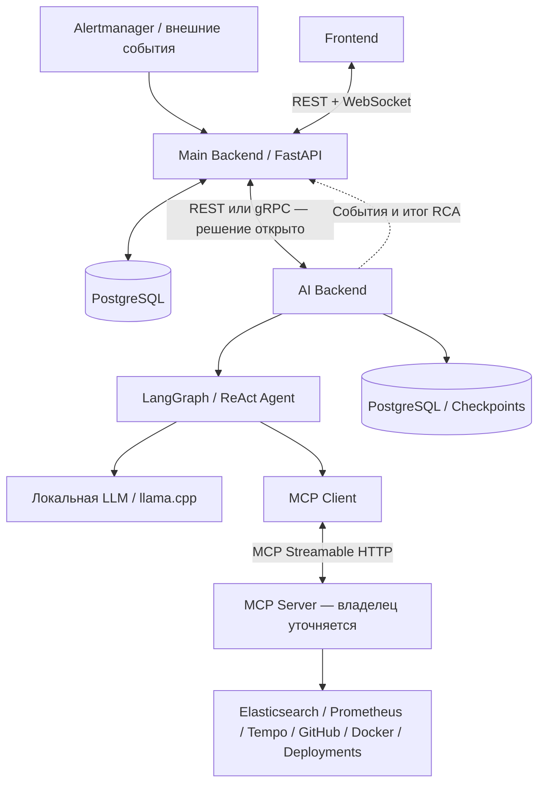

# AI Incident Investigator

**Система AI-расследования инцидентов в микросервисных приложениях**

**Статус документации:** `v0.2.0-draft` · **Актуально на:** 20.10.2026  
**Макеты:** [Figma — Observability / SRE Style (вариант B)](https://www.figma.com/design/JFUcynM2y9vIq6vJ7efTOc?node-id=6-2)  
**Назначение этой папки:** единая точка входа в API-контракты для Backend, AI, Frontend и Infra.

> **Важно:** это спецификация интерфейсов, а не готовый исходный код приложения. Часть технических решений остаётся в статусе `draft`; перед фиксацией API v1 нужно согласовать вопросы из [`10_OPEN_DECISIONS.md`](10_OPEN_DECISIONS.md).

---

## 1. Что мы разрабатываем

**AI Incident Investigator** — сервис, который помогает инженерам находить **первопричину технических инцидентов** в микросервисных системах.

Обычный мониторинг сообщает, *что* сломалось: выросло время ответа, появились HTTP 500, упал контейнер или исчерпан пул соединений. Наш продукт идёт дальше: подключает AI-агента к диагностическим источникам, исследует связанные события и формирует обоснованный **Root Cause Analysis (RCA)** — с гипотезами, доказательствами, причинно-следственной цепочкой и рекомендациями инженеру.

**Ключевая идея:** не просто пересказать алерт, а показать, *почему возникла проблема и на каких данных основан вывод*.

### Пример

После развёртывания новой версии `payment-service` приложение начало возвращать HTTP 500.

1. В систему поступает алерт, создаётся инцидент.
2. Запускается AI-расследование.
3. Агент находит в Elasticsearch ошибки ожидания соединений с PostgreSQL.
4. Проверяет Prometheus и видит, что пул соединений исчерпан.
5. Анализирует Tempo и обнаруживает задержки на DB spans.
6. Сопоставляет начало ошибок со временем deployment и изменениями GitHub.
7. Создаёт RCA: предполагаемая первопричина, подтверждающие факты, альтернативные гипотезы и рекомендации.
8. Инженер просматривает отчёт и **подтверждает, отклоняет или корректирует** вывод.

Если доказательств недостаточно, агент должен честно вернуть `inconclusive`, а не придумывать первопричину.

## 2. Что умеет продукт

| Возможность | Что получает пользователь |
|---|---|
| **Обзор системы** | Состояние сервисов, активные инциденты, ключевые показатели |
| **Управление инцидентами** | Список, фильтры, карточка инцидента, история и статусы |
| **AI Investigation** | Ручной или инициированный по политике запуск анализа, отмена и повторное расследование |
| **Live Investigation** | В реальном времени — шаги агента, вызовы инструментов, статусы, промежуточные результаты |
| **Hypotheses & Evidence** | До трёх гипотез, качественная уверенность, доказательства со ссылками на источники |
| **RCA Report** | Симптомы, первопричина или неопределённость, причинная цепочка, затронутые сервисы, рекомендации |
| **Human Review** | Подтверждение, отклонение или корректировка RCA человеком |
| **Интеграции** | Источники логов, метрик, трейсов, репозиториев, deployments и диагностики окружения |
| **Доступ и безопасность** | Роли Admin / Developer / Viewer, привязка доступа к проектам, вход с email OTP |

**Граница ответственности:** агент **не лечит production автоматически**. Он не выполняет произвольные shell-команды, не перезапускает контейнеры, не меняет конфигурацию и не делает rollback. Его диагностические инструменты — **read-only**.

### Экраны интерфейса

В утверждённом направлении **Figma B — Observability / SRE Style** спроектированы:

1. **Overview** — общая сводка и показатели состояния системы.
2. **Incidents** — реестр инцидентов, поиск, фильтры и переход в карточку.
3. **Live Investigations** — список запусков AI и поток действий агента.
4. **Service Map** — связи и состояния микросервисов.
5. **Logs & Metrics** — диагностика по Elasticsearch и Prometheus.
6. **Traces** — распределённые трассировки и spans из Tempo.
7. **Integrations** — управление подключениями внешних систем.
8. **Settings** — настройки рабочего пространства и параметры доступа.
9. **Incident Detail** — вкладки Overview, Live Investigation, Hypotheses, Evidence, Timeline, RCA Report.

Для обязательного email OTP дополнительно потребуются UI-состояния **Login** и **Verify Email OTP**; их нужно синхронизировать с уже разработанным Frontend.

---

## 3. Как работает система



### Основные компоненты

| Компонент | Владелец | Ответственность |
|---|---|---|
| **Frontend** | Расул | Страницы приложения, таблицы, графики, результаты RCA, получение realtime-событий |
| **Main Backend** | Юрий | Публичный REST/WebSocket API, пользователи, RBAC, проекты, инциденты, интеграции, события и сохранение результатов |
| **AI Backend** | Олег | Внутренний API для запуска расследований, LangGraph, состояние агента, ограничения, гипотезы и RCA |
| **Infrastructure** | Даниил | Docker Compose, PostgreSQL, observability, сетевые соединения, конфигурация, CI/CD |
| **MCP Server** | *Требует согласования* | Безопасные диагностические инструменты для AI-агента; распределение между Backend и AI пока не утверждено |

### Принципиальные архитектурные решения

- **Frontend не вызывает AI Backend напрямую**: весь пользовательский доступ проходит через Main Backend.
- **Между Main Backend и AI Backend нет RabbitMQ**. Они общаются напрямую; **REST или gRPC ещё не выбран**.
- Запуск расследования **асинхронный**. HTTP-запрос подтверждает принятие работы, но не держится открытым до окончания анализа.
- **MCP** используется для доступа агента к инструментам. Это отдельная граница, не замена внутреннему Backend ↔ AI API.
- Историю и результаты сохраняем надёжно; WebSocket используется для доставки обновлений, а после обрыва клиент может восстановить события через REST.
- **Retry создаёт новый запуск** с новым `investigation_id`, сохраняя историю предыдущего.
- **Завершение расследования не означает устранение инцидента**. Подтверждение RCA и изменение статуса самого инцидента — разные операции.

> Примечание: в старых общих спецификациях проекта могла встречаться схема с RabbitMQ. Для взаимодействия **Main Backend ↔ AI Backend** она устарела; ориентируйтесь на документацию в этой папке. Наличие RabbitMQ в отдельном демонстрационном e-commerce стенде — другой вопрос.

---

## 4. Что находится в этой папке

```text
AI_Incident_Investigator_API_Contracts_v0_2_EMAIL_OTP/
├── README.md                           # Этот файл: проект и навигация по документации
├── 00_README.md                        # Технический указатель по пакету контрактов
├── 01_ARCHITECTURE.md                  # Архитектура и ответственность сервисов
├── 02_ENDPOINT_MAP.md                  # Общая карта эндпоинтов
├── 03_DOMAIN_MODELS.md                 # Доменные модели, ID и статусы
├── 04_FRONTEND_API_AND_WS.md           # REST и WebSocket для UI
├── 05_INTERNAL_BACKEND_AI.md           # Связь Main Backend с AI Backend
├── 06_MCP_CONTRACTS.md                 # Контракты MCP-инструментов
├── 07_INGESTION.md                     # Приём алертов и deployment-событий
├── 08_SECURITY_AND_ERRORS.md           # Права, безопасность и ошибки
├── 09_IMPLEMENTATION_PLAN.md           # Очерёдность разработки и тестирования
├── 10_OPEN_DECISIONS.md                # Вопросы, которые ещё надо утвердить
├── 11_BACKEND_HANDOFF.md               # Основная инструкция Юрию по Backend
├── 12_AUTH_EMAIL_OTP.md                # Двухэтапный вход по email + OTP
├── 13_BACKEND_READINESS_AUDIT.md       # Проверка готовности Backend-спецификации
├── 14_CONTRACT_VALIDATION.md           # Что проверено в контрактах и примерах
├── manifest.json                       # Метаданные версии
├── openapi/                            # Формальные REST-контракты
├── schemas/                            # JSON Schema общих данных и событий
├── mcp/                                # Каталог MCP tools и их аргументов
├── proto/                              # Кандидат gRPC-контракта
└── examples/                           # Тестовые JSON и curl-примеры
```

### Документы в корне

| Файл | О чём он | Кому нужен |
|---|---|---|
| [`00_README.md`](00_README.md) | Как пользоваться пакетом, версия, список контрактов | Всем |
| [`01_ARCHITECTURE.md`](01_ARCHITECTURE.md) | Потоки данных, границы сервисов, сценарий расследования | Всем |
| [`02_ENDPOINT_MAP.md`](02_ENDPOINT_MAP.md) | Все операции публичного Backend, внутреннего AI API, события и MCP | Юрий, Олег, Расул |
| [`03_DOMAIN_MODELS.md`](03_DOMAIN_MODELS.md) | Project, Environment, Service, Incident, Investigation, Evidence, Hypothesis, RCA, Review и связи между ними | Юрий, Олег, Расул |
| [`04_FRONTEND_API_AND_WS.md`](04_FRONTEND_API_AND_WS.md) | Какие endpoints и realtime-события нужны экранам | Расул, Юрий |
| [`05_INTERNAL_BACKEND_AI.md`](05_INTERNAL_BACKEND_AI.md) | Запуск, статус, отмена, результат, callbacks, повторы и сбои без очереди | Юрий, Олег |
| [`06_MCP_CONTRACTS.md`](06_MCP_CONTRACTS.md) | MCP Streamable HTTP, инструменты, input/output, ограничения | Олег, Юрий |
| [`07_INGESTION.md`](07_INGESTION.md) | Alertmanager, сторонние алерты, история развёртываний | Юрий, Даниил |
| [`08_SECURITY_AND_ERRORS.md`](08_SECURITY_AND_ERRORS.md) | JWT, RBAC, защита секретов, HTTP-ошибки, service auth | Юрий, Расул, Олег |
| [`09_IMPLEMENTATION_PLAN.md`](09_IMPLEMENTATION_PLAN.md) | Разбиение на этапы, моки, проверки и критерии готовности | Все |
| [`10_OPEN_DECISIONS.md`](10_OPEN_DECISIONS.md) | Нерешённые архитектурные и продуктовые вопросы | Все, в первую очередь Олег и Юрий |
| [`11_BACKEND_HANDOFF.md`](11_BACKEND_HANDOFF.md) | Порядок реализации Main Backend и интеграционные требования | Юрий |
| [`12_AUTH_EMAIL_OTP.md`](12_AUTH_EMAIL_OTP.md) | Email/password → OTP → JWT, лимиты, защита, ошибки | Юрий, Расул, Даниил |
| [`13_BACKEND_READINESS_AUDIT.md`](13_BACKEND_READINESS_AUDIT.md) | Что Backend уже может реализовывать и что пока не согласовано | Юрий, Олег |
| [`14_CONTRACT_VALIDATION.md`](14_CONTRACT_VALIDATION.md) | Объём и ограничения выполненной проверки спецификаций | Все |
| [`manifest.json`](manifest.json) | Текущая версия и метаданные комплекта | CI, сопровождающие контрактов |

### `openapi/` — спецификации REST API

- [`main-backend.openapi.yaml`](openapi/main-backend.openapi.yaml) — публичное API для Frontend, ingestion API и внутренние callback-операции Main Backend. По нему можно проверять реализацию и генерировать клиентские типы.
- [`ai-backend-rest-candidate.openapi.yaml`](openapi/ai-backend-rest-candidate.openapi.yaml) — **кандидат** REST-интерфейса Main Backend ↔ AI Backend. Не означает, что REST окончательно выбран.

### `schemas/` — схемы передаваемых данных

Здесь находятся JSON Schema для доменных объектов, запуска AI, событий агента, итогового RCA, callback-результатов, WebSocket, ответов MCP, алертов, Alertmanager, deployment и email OTP. Схемы нужны для **контрактных тестов**, валидации сообщений и генерации моковых ответов.

### `mcp/` — каталог инструментов

[`tool-catalog.json`](mcp/tool-catalog.json) описывает **16 MCP-инструментов**: 14 запланированы для MVP и 2 для второго этапа. Это **интерфейсы**, а не реализация инструментов. Запросы к источникам должны быть ограничены правами и выполняться в read-only режиме.

### `proto/` — gRPC-кандидат

[`ai-backend-candidate.proto`](proto/ai-backend-candidate.proto) — черновой Protocol Buffers контракт на случай выбора gRPC между Backend и AI. Семантика операций должна оставаться согласованной с [`05_INTERNAL_BACKEND_AI.md`](05_INTERNAL_BACKEND_AI.md).

### `examples/` — образцы payload

JSON-примеры для OTP, старта расследования, AI events, финального результата, RCA, human review, WebSocket и Alertmanager; также есть [`curl-examples.md`](examples/curl-examples.md). Это **тестовые данные**, а не записи из реальной production-системы.

---

## 5. Основные API-границы

| Кто ↔ кто | Интерфейс | Для чего |
|---|---|---|
| **Frontend ↔ Main Backend** | REST `/api/v1/*` | Авторизация, проекты, сервисы, инциденты, расследования и отчёты |
| **Main Backend → Frontend** | WebSocket `/ws/v1/events` | Обновления статусов, действий агента, гипотез, Evidence |
| **Main Backend ↔ AI Backend** | REST `/internal/v1/*` **или gRPC** | Запуск и управление асинхронным расследованием, события, результат |
| **AI Agent ↔ MCP Server** | MCP Streamable HTTP | Вызов диагностических инструментов |
| **Мониторинг / CI → Main Backend** | `/api/v1/ingest/*` | Алерты и события развёртывания |

Точные пути, структуры JSON, параметры, HTTP-коды и ошибки смотрите в [`02_ENDPOINT_MAP.md`](02_ENDPOINT_MAP.md), `openapi/` и `schemas/`. Не используйте таблицу выше вместо формальных контрактов.

### Авторизация: обязательный OTP при каждом новом входе

```text
POST /api/v1/auth/login       → email + пароль → 202 OTP challenge (без JWT)
POST /api/v1/auth/otp/verify  → проверка кода → access/refresh credentials
POST /api/v1/auth/otp/resend  → повторная отправка кода
```

Параметры OTP в черновике: шестизначный код, 5 минут действия, 5 попыток проверки, 60 секунд между повторными отправками. Механизм приглашений, почтовый провайдер и детали хранения refresh-токена ещё требуют утверждения. Подробнее — [`12_AUTH_EMAIL_OTP.md`](12_AUTH_EMAIL_OTP.md).

---

## 6. MVP и последующие этапы

**Приоритет P0 — сначала работающий сквозной сценарий:**

1. Авторизация, email OTP, роли, проекты/окружения/сервисы.
2. Подключение источников и приём алертов.
3. Создание инцидента и запуск отдельного AI Backend без RabbitMQ.
4. LangGraph-агент с локальной LLM и безопасными MCP tools.
5. Сохранение истории событий и вывод хода расследования во Frontend.
6. Evidence, гипотезы, RCA и человеческая проверка.
7. Отмена, повторный запуск, обработка ошибок, таймаутов и восстановление данных.

**Приоритет P1/P2:** расширенные интерактивные Service Map, Logs Explorer, Trace Waterfall, дополнительные административные возможности; во втором этапе — документационный RAG и память о прошлых инцидентах.

**Ограничения начальной AI-реализации:** один активный запуск на executor, до **20 шагов**, **40 вызовов инструментов**, **20 минут** на расследование. Распределение ресурса при нескольких запросах без очереди необходимо отдельно согласовать.

---

## 7. Как команде использовать документацию

**Юрий — Main Backend.** Начать с [`11_BACKEND_HANDOFF.md`](11_BACKEND_HANDOFF.md), затем [`02_ENDPOINT_MAP.md`](02_ENDPOINT_MAP.md), [`03_DOMAIN_MODELS.md`](03_DOMAIN_MODELS.md), [`12_AUTH_EMAIL_OTP.md`](12_AUTH_EMAIL_OTP.md) и `openapi/main-backend.openapi.yaml`. Реализовывать endpoints по утверждённым DTO, писать контрактные тесты. Внутреннее разбиение Backend выбирает Юрий.

**Олег — AI Backend.** Использовать [`05_INTERNAL_BACKEND_AI.md`](05_INTERNAL_BACKEND_AI.md), [`06_MCP_CONTRACTS.md`](06_MCP_CONTRACTS.md), `schemas/`, `mcp/` и REST/gRPC-кандидат после выбора транспорта. Согласовать с Юрием исполнителя MCP Server и формат передачи событий.

**Расул — Frontend.** Использовать [`04_FRONTEND_API_AND_WS.md`](04_FRONTEND_API_AND_WS.md), `openapi/main-backend.openapi.yaml` и [`12_AUTH_EMAIL_OTP.md`](12_AUTH_EMAIL_OTP.md). Согласовать типы DTO, отображение статусов и страницы входа/OTP; UI ориентировать на Figma B.

**Даниил — Infra.** Использовать [`01_ARCHITECTURE.md`](01_ARCHITECTURE.md), [`07_INGESTION.md`](07_INGESTION.md), [`08_SECURITY_AND_ERRORS.md`](08_SECURITY_AND_ERRORS.md). Поднять окружение, телеметрию, checkpoint/БД и почтовый тестовый сервис; передавать секреты через конфигурацию, а не код.

**Общий процесс:** правки API сначала обсуждаются в контрактах, после утверждения одновременно обновляются Markdown, OpenAPI / Proto, JSON Schema, примеры и контрактные тесты. Нельзя независимо менять названия полей в одном репозитории.

---

## 8. Что ещё не утверждено

Перед тем как объявлять API **стабильной v1**, команде необходимо согласовать минимум:

- **REST или gRPC** между Main Backend и AI Backend.
- **Физическое расположение MCP Server** и распределение инструментов между командами.
- **Поведение при одновременных расследованиях**, когда executor занят и нет RabbitMQ.
- **Надёжную доставку итогового RCA**, восстановление после потери callback и service-to-service авторизацию.
- **Создание учётных записей и установку первого пароля**, email provider, refresh-token/session transport.
- Правила хранения Evidence/events и границу между P0 и расширенными диагностическими экранами.

Полный реестр — [`10_OPEN_DECISIONS.md`](10_OPEN_DECISIONS.md). Пока решение не утверждено, соответствующие `*-candidate.*` файлы остаются кандидатами, а не обязательными интерфейсами.

---

## 9. Что считается успешным результатом

Инженер подключает проект, система получает настоящий или воспроизведённый алерт, запускает расследование, показывает его ход в реальном времени и формирует **проверяемый RCA**, опирающийся на источники. Человек видит, что агент проверил, какие гипотезы подтвердились или были отвергнуты, и может оценить вывод. При недостатке сведений система корректно сообщает о неопределённости.

**Главный критерий качества продукта — доказательный анализ первопричины, а не количество экранов, инструментов или вызовов LLM.**
