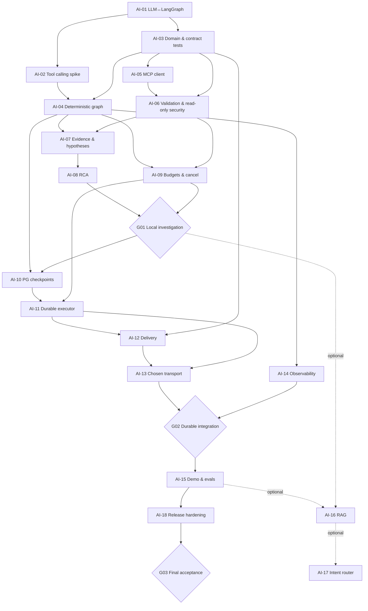

# Execution scheme — AI Backend

## 1. Режим работы

Основной исполнитель — один разработчик с Codex. **Параллельность в схеме означает независимость задач, а не требование запускать несколько агентов на одних файлах.** Если создаются отдельные worktrees, общие типы и контракты всё равно меняются по очереди с интеграционными барьерами.

```text
START: существующий bootstrap + импорт handoff
  |
 AI-01  LLM Provider + LangGraph smoke        [В РАБОТЕ В CODEX]
  |
  +--> AI-02  Qwen / llama.cpp native tool-call spike --+
  |                                                    |
  +--> AI-03  Typed domain + contract tests -----------+--> AI-04  Controlled Graph
            |                                           |
            +--> AI-05  MCP client ----------------------+--> AI-06  Safe tools
                                                             |
                                                       AI-07 Evidence/hypotheses
                                                             |
                                                       AI-08 RCA  +  AI-09 Budgets/cancel
                                                             |
                                                      ==== G01 LOCAL E2E ====
                                                             |
                            AI-10 PG checkpoints ----------> AI-11 Durable run executor
                                                             |
                                              AI-12 Events/results delivery
                                                             |
                  [approved transport + service auth] ---> AI-13 Integration
                                                             |
                                      AI-14 Observability ---+
                                                             |
                                                      ==== G02 DURABLE ====
                                                             |
                                          AI-15 Demo faults / Evals
                                                             |
                                          AI-18 Release hardening
                                                             |
                                                      ==== G03 FINAL ====

    OPTIONAL P2 (separate branch after baseline):
       G01 + AI-15 baseline ---> AI-16 RAG (Qdrant/embeddings/rerank)
                                            |
                                       AI-17 classifier/router
```

## 2. Базовая Mermaid диаграмма



## 3. Интеграционные барьеры

| Gate | Предпосылки | Что демонстрируем | Кто принимает |
|---|---|---|---|
| **G01** | AI-02…09, AI-01 закрыта | Запуск → diagnostic fake MCP → evidence → hypotheses → RCA/inconclusive, соблюдение бюджета | AI developer + review |
| **G02** | AI-10…14, одобрены transport/auth/PG policy | Persist/restart/cancel/dedup/callback; один API транспорт | AI developer + Main Backend owner |
| **G03** | AI-15, AI-18, G01/02 | Повторяемая демонстрация, безопасная диагностика и документы | Команда проекта |

**Нельзя перескочить G01**, сразу подключив реальный MCP Server без контроля схем и безопасности. **Нельзя закрыть G02 без утверждённых contract decisions** — допускаются transport-neutral результаты, но это не полноценная межсервисная интеграция.

## 4. Работа по веткам

- Ветка текущего bootstrap: `chore/ai-backend-bootstrap` (проверить действующий default branch, не предполагать `main`).
- Пример Story ветки: `feat/ai-05-mcp-client`. Каждую новую ветку создавать от согласованного интегрированного baseline.
- AI-02 и AI-03 можно проектировать параллельно, но общий `src/ai_agent/agent`/LLM Provider после AI-01 не должен перезаписываться двумя agent sessions.
- Contract tests и mock fixtures — общий слой. Сначала влить AI-03, затем использовать его типы в AI-04/AI-05.
- Результаты optional AI-16/17 не должны блокировать release MVP.
